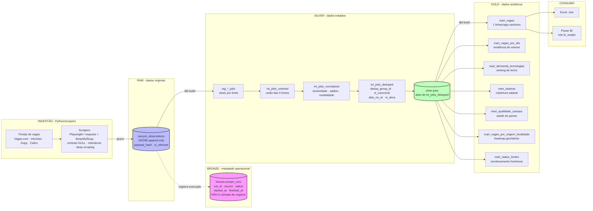

# Hub Vagas — Arquitetura de Dados

Este documento descreve a **arquitetura real** do projeto, ou seja, como os dados
de fato circulam entre as camadas, com responsabilidades claras para cada uma.
Não é um diagrama idealizado: reflete o código implementado em `app/`, `dbt/`
e `infra/`.

> **Nota importante:** não confunda a arquitetura Medallion com a mera criação
> de schemas chamados `raw`, `bronze`, `silver` e `gold`. Cada camada aqui tem
> uma responsabilidade real. A `bronze.scrape_runs` é metadado operacional de
> execução, não uma camada de dados de negócio. Uma "Bronze de negócio" é
> opcional e só deve ser criada se trouxer benefício concreto.

---

## Visão geral do fluxo



---

## Responsabilidades por camada

| Camada | Onde fica | O que armazena | Responsabilidade |
|--------|-----------|----------------|------------------|
| **Ingestão** | `app/scrapers/`, `app/services/collector_service.py` | Nada (apenas coleta) | Buscar vagas nos portais, aplicar contrato de NULL e filtro de relevância. Cada scraper é independente; falha de um não interrompe os outros. |
| **Raw** | `raw.job_observations` (schema `raw`) | Payload JSONB bruto, `payload_hash`, `is_relevant`, `run_id`, `source`, `source_job_id`, `collected_at` | Landing zone append-only. Uma linha por observação de coleta. Dedup por `(source, source_job_id, payload_hash)`. Não há normalização de negócio aqui. |
| **Bronze** | `bronze.scrape_runs` (schema `bronze`) | `run_id`, `source`, `status`, `pages_processed`, `jobs_found`, `started_at`, `finished_at` | Metadado operacional de execução por fonte. Serve para freshness (warn 24h / error 72h). **Não é camada de dados de negócio.** |
| **Silver** | `silver.jobs` (dbt: `stg_*` → `int_jobs_*` → `jobs`) | Vagas normalizadas, dedup_group_id, is_canonical, dias_no_ar, is_ativa | Normalização (senioridade, localização, salário, modalidade), dedup cross-portal, validação de NULLs, enriquecimento controlado. Nenhuma linha é apagada; apenas marcada como canônica ou não. |
| **Gold** | `gold.mart_*` (dbt models) | Marts analíticos agregados | Indicadores de mercado: vagas por tecnologia, senioridade, localização, salário, tendências de volume, saúde do parser. Consumido por Power BI e Excel. |

---

## Fluxo conceitual proposto (detalhado)

```
Portais (Vagas.com, InfoJobs, Gupy, Catho)
        │
        ▼
Scrapers Python (Playwright/requests + BeautifulSoup)
        │
        ├─ contrato NULL: campo sem informação → NULL (nunca "Não informado")
        ├─ filtro de relevância: is_relevant + motivo_relevancia (Opção A: tudo é gravado)
        └─ deep scraping opcional: busca página de detalhe para descrição/salário completos
        │
        ▼
Raw: raw.job_observations (append-only, JSONB)
        │  ├─ run_id (UUID da execução)
        │  ├─ source (nome do portal)
        │  ├─ source_job_id (ID da vaga no portal)
        │  ├─ collected_at (timestamp da coleta)
        │  ├─ payload_hash (SHA-256 do payload bruto)
        │  ├─ is_relevant (resultado do filtro de relevância)
        │  └─ raw_payload (fragmento HTML + campos extraídos)
        │
        ├─ dedup: mesma (source, source_job_id, payload_hash) não é regravada
        ├─ bronze.scrape_runs registra execução (metadado operacional)
        │
        ▼
dbt build: staging (stg_*_jobs) → unioned → normalized → deduped
        │  ├─ NULL_IF placeholder ("Confidencial", "Localização não informada")
        │  ├─ normalize_seniority + classify_seniority_cascade (única fonte de verdade)
        │  ├─ extract_salary: salario_texto, salario_min, salario_max, salario_tipo
        │  ├─ dedup_group_id + is_canonical (linha mais recente do grupo)
        │  ├─ first_seen_at / last_seen_at / dias_no_ar / is_ativa
        │  └─ data_publicacao_precisao (hora / dia / estimada)
        │
        ▼
Silver: silver.jobs (tabela, não view)
        │  ├─ apenas is_canonical = true vai para os marts
        │  └─ dedup é por portal (mesma vaga em 2 portais conta 2×)
        │
        ▼
Gold: mart_vagas, mart_salarios, mart_demanda_tecnologias, etc.
        │  ├─ marts agregados para Power BI / Excel
        │  └─ +grants select: ['bi_reader'] no dbt_project.yml
```

---

## Regras de dados

1. **Campo sem informação é `NULL`.** Nunca textos tipo "Não informado", "Confidencial" ou "Localização não informada". O dbt aplica `null_if_placeholder` para converter esses textos em `NULL`.

2. **Relevância.** Todas as vagas são gravadas na raw com `is_relevant` e `motivo_relevancia`. A Silver filtra `is_relevant = true` nos marts. Isso permite responder "quantas vagas boas o filtro descartou?".

3. **Deduplicação.**
   - Raw: dedup por `(source, source_job_id, payload_hash)`.
   - Silver: todas as linhas são mantidas com `dedup_group_id` e `is_canonical`. Os marts usam apenas as linhas canônicas.
   - Dedup é **por portal**: a mesma vaga em dois portais conta duas vezes.

4. **Senioridade.** Única fonte de verdade: macro dbt `normalize_seniority` + `classify_seniority_cascade`. "PL/SQL", "PL-SQL", "PL SQL" e "PL-300" **não** são Pleno.

5. **Salário.** "A combinar" **não** é fallback da descrição; só aparece quando o portal informa explicitamente.

6. **Datas.** `data_publicacao` em UTC (`timestamptz`); precisão `hora` / `dia` / `estimada`. Conversão para São Paulo só na apresentação.

---

## O que a bronze.scrape_runs NÃO é

- Não é uma camada de dados de negócio.
- Não armazena vagas, apenas metadado de execução (run_id, source, status, timestamps, contagens).
- Não participa do fluxo raw → silver → gold de dados de vagas.
- Alimenta apenas `mart_status_fontes` para monitoramento de freshness.

---

## ADRs relacionados

- `docs/adr/0001-jobs-como-raw.md` — decisão de usar `raw.job_observations` como raw.
- `docs/adr/0002-filtro-de-relevancia.md` — decisão Opção A (salvar tudo, Silver filtra).
