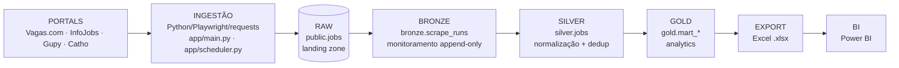
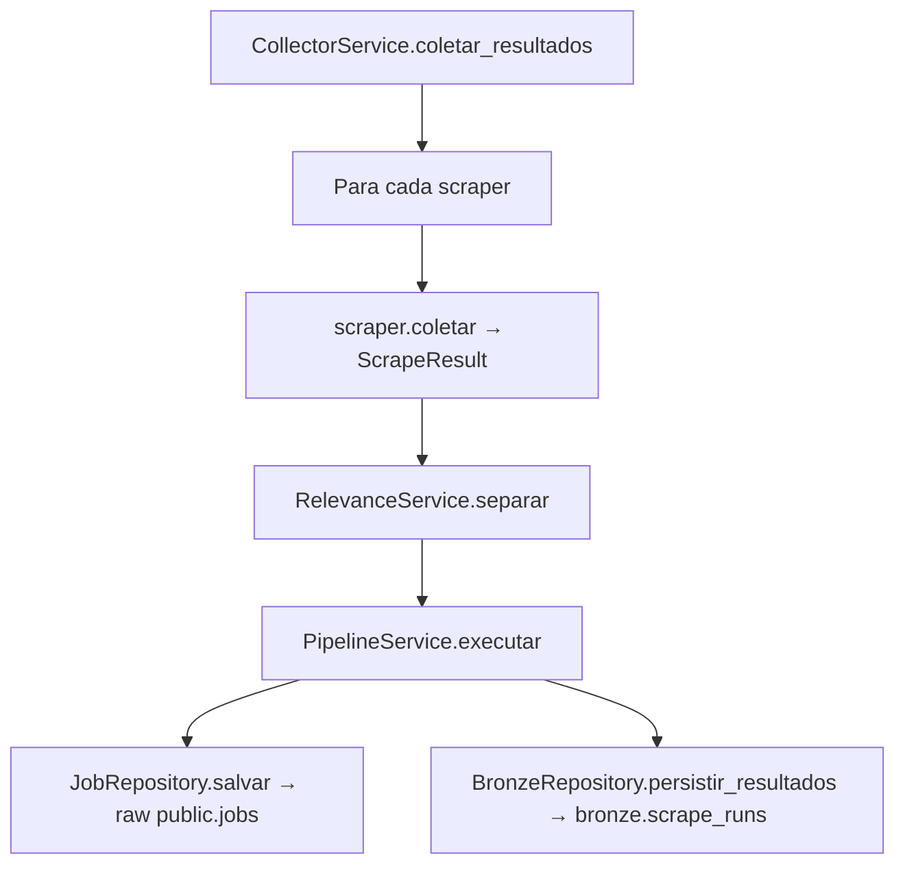
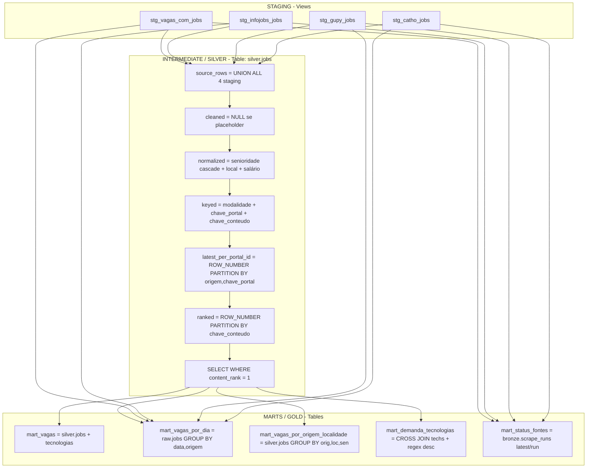

# Hub Vagas — Documentação Arquitetural

> **Versão:** 1.0 | **Data:** 2026-11-17 | **Status:** Em desenvolvimento (execução local)

---

## 1. Visão Geral da Arquitetura



**Princípio fundamental:** Separação de responsabilidades
- **Python (`app/`)**: Apenas ingestão (scrape → Raw `public.jobs` + Bronze `scrape_runs`)
- **dbt (`dbt/`)**: Todas as transformações (Raw → Bronze → Silver → Gold)

---

## 2. Estrutura de Diretórios

```
hub_vagas/
├── app/                          # Camada de aplicação (Python)
│   ├── config/                   # Configurações (settings.py)
│   ├── constants/                # Constantes (seletores CSS)
│   ├── database/                 # ORM SQLAlchemy + conexão
│   │   ├── connection.py         # Engine, sessão, criação DB
│   │   ├── models.py             # Base declarativa
│   │   ├── job_model.py          # Tabela raw jobs
│   │   ├── bronze_model.py       # Tabela bronze.scrape_runs
│   │   ├── tech_model.py         # Tabela technologies
│   │   └── job_tech_model.py     # Associação job↔technology
│   ├── repositories/             # Data Access Layer
│   │   ├── job_repository.py     # Upsert + dedup raw jobs
│   │   └── bronze_repository.py  # Persistência scrape_runs
│   ├── scrapers/                 # Coletores por portal
│   │   ├── base_scraper.py       # Classe abstrata + ScrapeResult
│   │   ├── vagas_scraper.py      # Playwright + BeautifulSoup
│   │   ├── infojobs_scraper.py   # requests + BeautifulSoup
│   │   ├── gupy_scraper.py       # Playwright (seletores a calibrar)
│   │   ├── catho_scraper.py      # requests + parser dedicado
│   │   ├── catho_parser.py       # Parser HTML Catho
│   │   └── parser_utils.py       # Utilitários de parsing
│   ├── schemas/                  # Validação Pydantic
│   │   └── job_schema.py         # JobSchema (contrato de entrada)
│   ├── services/                 # Regras de negócio
│   │   ├── collector_service.py  # Orquestra scrapers
│   │   ├── pipeline_service.py   # Pipeline ingestão completa
│   │   ├── relevance_service.py  # Filtro por título (termos de dados)
│   │   ├── normalize_service.py  # Normalização: local, empresa, modalidade
│   │   ├── seniority_service.py  # Cascata de senioridade (5 níveis)
│   │   ├── salary_service.py     # Extração salário (card + descrição)
│   │   ├── tech_service.py       # Extração tecnologias (18 termos)
│   │   ├── export_service.py     # Geração Excel
│   │   └── scheduler_service.py  # APScheduler (cron/intervalo)
│   ├── utils/                    # Utilitários
│   │   ├── logger.py             # Logging rotativo (5MB, 3 backups)
│   │   ├── text_utils.py         # Normalização texto, chave_conteudo
│   │   └── date_utils.py         # Parsing datas relativas/absolutas
│   ├── tests/                    # Testes unitários + integração
│   │   ├── conftest.py           # Mock global DB (SQLAlchemy)
│   │   ├── fixtures/             # HTML real dos portais
│   │   └── test_*.py             # Testes passando (suíte mockada, sem PostgreSQL)
│   ├── main.py                   # Entrypoint: scrape → raw jobs
│   ├── transform.py              # Entrypoint: dbt build
│   ├── run_dbt.py                # Wrapper dbt (carrega .env → profiles.yml)
│   ├── scheduler.py              # Agendador CLI (diário/intervalo)
│   └── export_excel.py           # Exporta gold.mart_vagas → .xlsx
│
├── dbt/                          # Camada de transformação (SQL)
│   ├── macros/                   # Macros reutilizáveis
│   │   ├── select_raw_jobs.sql   # Seleciona raw por fonte
│   │   ├── normalize_*.sql       # Normalização campos
│   │   ├── classify_seniority_cascade.sql  # Senioridade SQL
│   │   ├── monitored_technologies.sql      # 18 techs monitoradas
│   │   └── generate_schema_name.sql        # Nomes de schema dinâmicos
│   ├── models/
│   │   ├── sources.yml           # Fontes: raw.jobs + bronze.scrape_runs (+ raw.job_observations em P3)
│   │   ├── staging/              # Views por fonte (stg_*_jobs)
│   │   ├── intermediate/         # Silver: jobs.sql (core transform)
│   │   │   └── intermediate.yml  # Testes Silver
│   │   └── marts/                # Gold: mart_vagas, mart_vagas_por_dia, etc.
│   │       └── marts.yml         # Testes Gold
│   ├── tests/                    # Testes de qualidade de dados
│   │   ├── assert_silver_*.sql   # Unicidade, NULL%, freshness, placeholders
│   │   └── assert_gold_tecnologias.sql
│   ├── dbt_project.yml           # Config dbt (inclui `vars:` em P2)
│   └── profiles.yml.example      # Template perfis (sem segredos)
│
├── docs/
│   └── adr/
│       └── 001-bronze-payload-para-public-jobs.md
│
├── infra/migrations/             # Evolução schema (001-005 + 006 raw.job_observations em P3)
├── .env.example                  # Template variáveis ambiente
├── requirements.txt              # Dependências Python
└── README.md                     # Documentação completa (histórico; fonte da verdade: ARCHITECTURE.md)
```

---

## 3. Fluxo de Dados Detalhado

### 3.1 Ingestão (Python) — `app/main.py` → `PipelineService`



**Detalhes do `JobRepository.salvar()`:**
1. Grava os campos conforme vieram do scraper (sem normalização de negócio).
2. Busca duplicata por: `link` → `(origem, id_externo)` → `chave_conteudo`.
3. Se existe: preenche apenas campos NULL (nunca sobrescreve), retorna `"duplicada"`.
4. Se nova: INSERT + extrai tecnologias da descrição → `job_technologies`.

### 3.2 Transformação (dbt) — `dbt build`



---

## 4. Modelos de Dados por Camada

### 4.1 Raw — `public.jobs` (Landing Zone)

| Coluna | Tipo | Constraints | Origem |
|--------|------|-------------|--------|
| `id` | int | PK | Auto |
| `titulo` | string | NOT NULL | Scraper |
| `empresa` | string | NULL se placeholder | Scraper |
| `senioridade` | string | NULL se placeholder | Scraper |
| `localizacao` | string | NULL se placeholder | Scraper |
| `descricao` | text | NULL se placeholder | Scraper |
| `salario` | string | NULL se placeholder | Scraper |
| `link` | string | UK, NOT NULL | Scraper |
| `origem` | string | "Vagas.com"\|"InfoJobs"\|"Gupy"\|"Catho" | Scraper |
| `data_coleta` | datetime | NOT NULL, default now() | Pipeline |
| `id_externo` | string | UK com origem | Scraper (regex do link) |
| `data_publicacao` | datetime | | Scraper |
| `modalidade` | string | | Scraper |
| `experiencia` | string | | Scraper |
| `escolaridade` | string | | Scraper |
| `qtd_posicoes` | int | | Scraper |
| `chave_conteudo` | string | INDEX | Repository (normalizada) |

**Dedup Raw**: `UNIQUE(link)` + `UNIQUE(origem, id_externo)`

### 4.2 Bronze — `bronze.scrape_runs` (Monitoramento)

| Coluna | Tipo | Constraints |
|--------|------|-------------|
| `run_id` | uuid | PK (com source) |
| `source` | string | PK (com run_id) |
| `status` | string | success\|empty\|partial\|failed |
| `pages_processed` | int | DEFAULT 0 |
| `jobs_found` | int | DEFAULT 0 |
| `error` | text | |
| `started_at` | timestamptz | NOT NULL |
| `finished_at` | timestamptz | NOT NULL |
| `created_at` | timestamptz | DEFAULT now() |

### 4.3 Silver — `silver.jobs` (Normalizada + Dedup)

| Coluna | Tipo | Notas |
|--------|------|-------|
| `raw_job_id` | int | FK para raw.id |
| `origem` | string | |
| `link` | string | |
| `id_externo` | string | |
| `titulo` | string | NOT NULL |
| `empresa` | string | NULL = desconhecido |
| `senioridade` | string | Normalizada (9 valores) |
| `localizacao` | string | Preposições minúsculas |
| `descricao` | text | |
| `salario` | string | Extraído card + descrição |
| `modalidade` | string | Remoto/Híbrido/Presencial/NULL |
| `experiencia` | string | |
| `escolaridade` | string | |
| `qtd_posicoes` | int | |
| `data_publicacao` | datetime | |
| `chave_conteudo` | string | Dedup cross-portal |
| `data_coleta` | datetime | |

**Dedup Silver (2-pass):**
1. `PARTITION BY origem, chave_portal` → latest por ID portal
2. `PARTITION BY chave_conteudo` → latest por conteúdo (título+empresa+local)

### 4.4 Gold — Marts Analíticos

| Mart | Granularidade | Uso |
|------|---------------|-----|
| `mart_vagas` | 1 linha/vaga | Export Excel, Power BI |
| `mart_vagas_por_dia` | (data, origem) | Tendência volume |
| `mart_vagas_por_origem_localidade` | (origem, local, senioridade) | Heatmap geo/sênior |
| `mart_demanda_tecnologias` | tecnologia | Ranking techs |
| `mart_status_fontes` | origem | Monitoramento freshness |

---

## 5. Padrões de Design Aplicados

| Padrão | Onde | Descrição |
|--------|------|-----------|
| **Repository Pattern** | `job_repository.py`, `bronze_repository.py` | Isola lógica de persistência |
| **Strategy Pattern** | `base_scraper.py` + subclasses | Cada portal implementa `coletar()` |
| **Template Method** | `BaseScraper.coletar()` | Fluxo fixo, parsing customizável |
| **Pipeline/Chain of Responsibility** | `seniority_service.py` | Cascata: portal → título → descrição → experiência → anos |
| **Decorator (Logging)** | `utils/logger.py` | Rotação arquivo + console |
| **Factory** | `run_dbt.py` | Cria `profiles.yml` dinâmico do `.env` |
| **Configuration as Code** | `settings.py` (Pydantic), `dbt_project.yml` | Tipagem + validação |
| **Idempotency** | Migrações SQL, `JobRepository.salvar()` | Re-executável sem side effects |
| **Append-Only** | `bronze.scrape_runs` | Histórico imutável de execuções |
| **Separation of Concerns** | Python (ingestão) / dbt (transformação) | Linguagem certa para cada etapa |

---

## 6. Tecnologias Utilizadas

| Categoria | Tecnologia | Versão/Detalhes |
|-----------|------------|-----------------|
| **Linguagem** | Python | 3.12+ |
| **Database** | PostgreSQL | 15+ |
| **ORM** | SQLAlchemy | 2.x (sync) |
| **Validação** | Pydantic | v2 |
| **Scraping** | Playwright | Chromium (Vagas.com, Gupy) |
| **Scraping** | requests + BeautifulSoup | InfoJobs, Catho |
| **Transformação** | dbt-core + dbt-postgres | 1.9.x |
| **Agendamento** | APScheduler | Cron + intervalo |
| **Logging** | stdlib logging + rotating handler | 5MB, 3 backups |
| **Testes** | pytest | Suíte mockada (sem PostgreSQL), CI por push/PR |
| **CI/CD** | GitHub Actions | pytest a cada push/PR (`dbt build` não roda no CI: precisa de PostgreSQL) |
| **Deploy** | Histórico: Render (Cron Job + PostgreSQL) — descontinuado |
| **Export/BI** | openpyxl → Excel → Power BI | `export_service.py` |

---

## 7. Pontos de Atenção / Otimizações / Melhorias

### 7.1 Performance

| Área | Gargalo Atual | Otimização Sugerida |
|------|---------------|---------------------|
| **Scraping Vagas.com** | Playwright (browser real) lento | Avaliar API não-oficial ou request direto se possível |
| **Scraping Gupy** | Seletores não calibrados, Playwright | Priorizar calibração; considerar API GraphQL |
| **Dedup Silver** | 2 `ROW_NUMBER()` sobre 300+ rows | OK para volume atual; particionar por `data_coleta` se >100k |
| **Extração Techs** | `CROSS JOIN` 18 techs × 300 vagas = 5.4k rows | OK; usar `tsvector`/GIN index se descrições longas |
| **dbt Build** | Rebuild full a cada run | Usar modelos incrementais (`is_incremental()`) para Silver/Gold |

### 7.2 Escalabilidade

| Limitação Atual | Solução |
|-----------------|---------|
| **Single-thread scrapers** | Paralelizar `CollectorService` com `ThreadPoolExecutor` ou `asyncio` |
| **Scheduler em processo único** | Migrar para Airflow/Prefect/Dagster ou Celery Beat + Workers |
| **DB local único** | Read replicas para dbt; connection pooling (PgBouncer) |
| **Estado em memória** | Persistir `run_id` + checkpoint para resume em falha |
| **Rate limiting** | Implementar backoff exponencial + respect `robots.txt` |

### 7.3 Manutenibilidade

| Dívida Técnica | Ação |
|----------------|------|
| **Seletores CSS hardcoded** | `constants/selectors.py` OK; adicionar testes visuais de regressão |
| **Thresholds de teste hardcoded** | `assert_silver_null_pct.sql` calibrado manualmente → tornou-se configurável via `vars` em `dbt_project.yml` (P2) |
| **Cascata senioridade duplicada** | Python (`seniority_service`) + SQL (`classify_seniority_cascade`) → single source of truth (macro dbt) |
| **Gupy sem filtro relevância** | Aplicar `RelevanceService` + normalização NULL |
| **Catho sem modalidade/salario/descricao** | Buscar página de detalhe (HTML fragment já salvo no `raw_payload`) — gate robots/ToS |
| **Testes dbt SKIP em Gold** | `mart_demanda_tecnologias`, `mart_vagas`, etc. marcados como SKIP → corrigir dependências (P2) |

### 7.4 Qualidade de Dados

| Métrica | Atual | Target |
|---------|-------|--------|
| **Freshness Silver** | warn 24h / error 72h (alinhado a `sources.yml`) | < 24h (ingestão diária) |
| **NULL % modalidade** | 99.3% | < 50% (buscar página detalhe Vagas.com) |
| **NULL % salario** | 19% | < 30% (melhorar extração descrição) |
| **NULL % senioridade** | 54% | < 20% (melhorar cascata + portal) |
| **Tech detection rate** | 3.3% | > 30% (Catho sem descrição é o problema) |

**Freshness:** medir pela última coleta com `status = success` em `bronze.scrape_runs` (`finished_at`), não pela última tentativa. Limiares: `warn_after: 24h`, `error_after: 72h`, declarados em `dbt/models/sources.yml`.

**Severidade dos testes:** `severity: warn` + meta documentada para limitações conhecidas (modalidade, salário); `severity: error` para invariantes (unicidade, sem placeholder).

### 7.5 Roadmap Arquitetural

```
CURTO PRAZO (1-2 sprints)
├── Calibrar Gupy (seletores + relevância + NULL contract)
├── Buscar página detalhe Vagas.com/Catho (salário, modalidade, descrição)
├── Modelos dbt incrementais (Silver/Gold)
└── Unificar cascata senioridade (macro dbt single source)

MÉDIO PRAZO (1-2 meses)
├── Migrar agendamento para Airflow/Prefect
├── Adicionar portal Remotar + Sólides
├── Pipeline de alertas (Slack/Email) para falhas/freshness
└── Testes de contrato de schema (dbt-expectations / Great Expectations)

LONGO PRAZO (3-6 meses)
├── Streaming/near-real-time (Kafka + Flink/dbt streaming)
├── Feature store para ML (salary prediction, seniority classification)
├── Data contracts formais (OpenLineage / dbt contracts)
└── Multi-tenant (vários clientes, isolamento por schema)
```

---

## 8. Checklist de Code Review / Auditoria

- [ ] **Segurança**: `.env` no `.gitignore`? Segredos no Secret Manager (prod)?
- [ ] **SSL**: `DB_SSLMODE=require` em produção? `REQUESTS_CA_BUNDLE` para proxy?
- [ ] **Migrações**: Backup antes da 004? `pg_dump` testado?
- [ ] **Idempotência**: `main.py` re-executável? `dbt build` re-executável?
- [ ] **Testes**: `pytest` passa local? `dbt build` passa local?
- [ ] **Monitoramento**: `bronze.scrape_runs` consultado? Alertas configurados?
- [ ] **Documentação**: `README.md` atualizado (banner histórico)? Diagramas Mermaid renderizam?
- [ ] **Performance**: Índices em `chave_conteudo`, `origem`, `data_coleta`?
- [ ] **Limpeza**: `bronze.job_observations` removida (migração 005 aplicada)?

---

## 9. Execução Rápida

```bash
# 1. Setup
git clone https://github.com/Willian-Cruz/hub_vagas.git
cd hub_vagas
python -m venv venv
source venv/bin/activate  # Windows: venv\Scripts\activate
pip install -r requirements.txt
playwright install chromium

# 2. Config
cp .env.example .env
# edite .env com credenciais PostgreSQL

# 3. Migrações (se banco existente)
psql -h localhost -p 5432 -U usuario -d hub_vagas -f infra/migrations/004_jobs_novos_campos.sql

# 4. Pipeline completo
python app/main.py           # Ingestão → raw + bronze
python app/transform.py      # dbt build → bronze → silver → gold
python app/export_excel.py   # Gera data/exports/vagas.xlsx

# 5. Agendado (produção)
python app/scheduler.py --com-transformacao  # Diário 06:00 + dbt auto

# 6. Testes
python -m pytest app/tests/ -v
```

---

> **Nota:** Este documento deve ser mantido sincronizado com a evolução do código. Atualize ao adicionar portais, alterar schemas, ou mudar padrões arquiteturais. O `README.md` mantém o histórico detalhado (etapas 1 a 15) e está marcado como histórico a partir da versão 06/11/2026.
