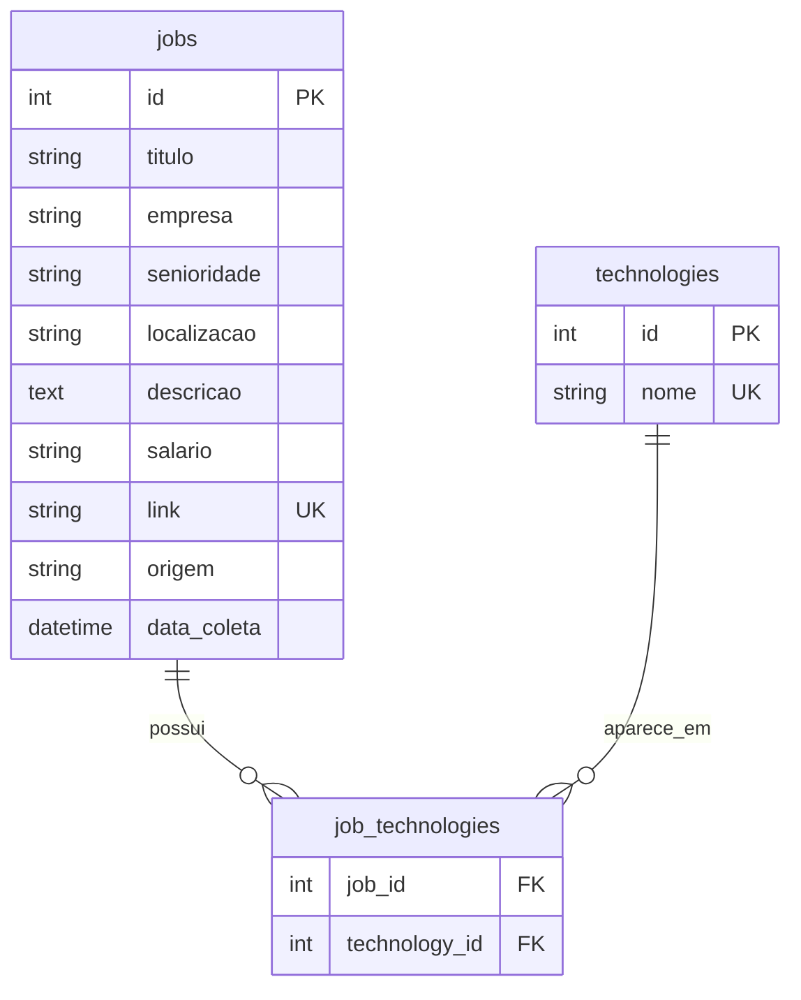

# Hub Vagas — Job Market Analytics

[](https://github.com/Willian-Cruz/hub_vagas/actions/workflows/tests.yml)


Pipeline ETL em Python que coleta vagas de Dados e Tecnologia em portais brasileiros, normaliza os campos, extrai as tecnologias citadas e grava tudo em PostgreSQL. Os dados tratados são exportados para Excel e analisados em um dashboard no Power BI.

A execução é em **lote (batch)**: uma vez por dia via APScheduler, ou manualmente.

---

## Arquitetura


| Etapa | Onde fica | O que faz |
| --- | --- | --- |
| Coleta | `app/scrapers/`, `app/services/collector_service.py` | Roda cada scraper em sequência; a falha de um não interrompe os outros |
| Validação | `app/schemas/job_schema.py` | Garante o formato de cada vaga com Pydantic |
| Normalização | `app/services/normalize_service.py`, `salary_service.py`, `tech_service.py` | Padroniza senioridade e localização, extrai salário via regex e identifica tecnologias |
| Persistência | `app/repositories/` | Grava em PostgreSQL; um link já existente é contado como duplicado |
| Orquestração | `app/services/pipeline_service.py`, `app/scheduler.py` | Executa coleta + persistência e registra métricas (coletadas, salvas, duplicadas, erros, duração) |
| Exportação | `app/services/export_service.py`, `app/export_excel.py` | Gera `data/exports/vagas.xlsx` com as tecnologias agregadas por vaga |

## Modelo de dados



---

## Estrutura do projeto

```text
hub_vagas/
├── .github/workflows/
│   └── tests.yml              # CI: roda a suíte de testes a cada push e PR na main
├── app/
│   ├── config/settings.py     # leitura do .env
│   ├── constants/selectors.py # seletores CSS dos portais
│   ├── database/              # conexão e modelos SQLAlchemy (jobs, technologies, job_technologies)
│   ├── repositories/          # gravação no banco (job_repository, tech_repository)
│   ├── schemas/job_schema.py  # validação Pydantic
│   ├── scrapers/              # base_scraper, vagas_scraper, infojobs_scraper, gupy_scraper
│   ├── services/              # analytics, collector, export, job, normalize, pipeline,
│   │                          # salary, scheduler, tech
│   ├── tests/                 # 9 arquivos de teste + conftest.py (banco mockado)
│   ├── utils/logger.py        # logging com rotação de arquivo
│   ├── debug_vagas.py         # diagnóstico visual do scraper do Vagas.com
│   ├── export_excel.py        # ponto de entrada da exportação
│   ├── main.py                # execução única do pipeline
│   └── scheduler.py           # execução agendada
├── .env.example
├── requirements.txt
└── LICENSE
```

---

## Portais

| Portal | Situação |
| --- | --- |
| Vagas.com | Implementado |
| InfoJobs | Implementado |
| Gupy | Implementado, com calibração de seletores pendente (`app/scrapers/gupy_scraper.py`) |
| LinkedIn, Indeed, Glassdoor, Catho | Planejados |

## Tecnologias identificadas nas descrições

18 termos monitorados em `app/services/tech_service.py`: Python, SQL, AWS, Azure, GCP, Spark, Airflow, Kafka, Docker, Kubernetes, PostgreSQL, MySQL, Oracle, MongoDB, Power BI, Tableau, Databricks e Snowflake.

---

## Como executar

### 1. Instalação

```bash
git clone https://github.com/Willian-Cruz/hub_vagas.git
cd hub_vagas
python -m venv venv
source venv/bin/activate        # Windows: venv\Scripts\activate
pip install -r requirements.txt
playwright install chromium
```

### 2. Configuração

```bash
cp .env.example .env
```

```env
DB_USER=seu_usuario
DB_PASSWORD=sua_senha
DB_HOST=localhost
DB_PORT=5432
DB_NAME=hub_vagas
```

### 3. Pipeline

```bash
# Execução única (coleta + persistência). Sai com código 1 se falhar
# ou se nenhuma vaga for coletada.
python app/main.py

# Execução agendada: todo dia às 06:00, horário de São Paulo (padrão)
python app/scheduler.py
python app/scheduler.py --hora 8 --minuto 30   # horário customizado
python app/scheduler.py --intervalo 2          # a cada N horas (debug)
```

Exemplo de log:

```text
PIPELINE INICIADO
Etapa 1/2: Coletando vagas...
Coletadas: 87 vagas
Etapa 2/2: Persistindo no banco...
Persistência concluída — Salvas: 54 | Duplicadas: 33 | Erros: 0
PIPELINE CONCLUÍDO
```

Os logs ficam em `logs/pipeline.log`, com rotação a cada 5 MB (3 backups).

### 4. Exportação para Excel / Power BI

```bash
cd app
python export_excel.py
```

Gera `data/exports/vagas.xlsx`, que alimenta o dashboard no Power BI.

---

## Testes

```bash
cd app
pytest tests/ -v
```

A suíte usa um mock global do banco (`conftest.py`), então roda sem PostgreSQL. São 133 testes em 9 arquivos, cobrindo scrapers, normalização, salário, analytics, repositório, pipeline, agendamento, exportação e configuração. O GitHub Actions executa tudo a cada push e pull request na `main`.

---

## Histórico

| Etapa | Entregas |
| --- | --- |
| 1 a 2 | Estrutura, conexão com PostgreSQL, persistência e validação com Pydantic |
| 3 | Scrapers do Vagas.com e InfoJobs, coleta consolidada no CollectorService |
| 4 | Extração de tecnologias e relação many-to-many `jobs` ↔ `technologies` |
| 5 | Normalização de senioridade e localização, extração de salário |
| 6 a 7 | AnalyticsService, PipelineService com métricas, APScheduler e logging estruturado |
| 8 | Deploy em Render (Cron Job + PostgreSQL), Docker e dashboard HTML no GitHub Pages |
| 9 (jun/2026) | Deploy em nuvem e dashboard HTML descontinuados; análise migrada para exportação Excel + Power BI |
| 10 (out/2026) | Correções de métricas do pipeline, código de saída do `main.py` e testes do repositório |

---

## Próximos passos

- Calibrar os seletores do scraper da Gupy
- Publicar prints do dashboard do Power BI neste README
- Adicionar novos portais (LinkedIn, Indeed, Glassdoor, Catho)

---

## Autor

**Willian da Cruz** — projeto de estudo e portfólio em Engenharia de Dados.

[](https://www.linkedin.com/in/williandacruz/)
[](https://github.com/Willian-Cruz)

## Licença

MIT. Veja o arquivo [LICENSE](LICENSE).
