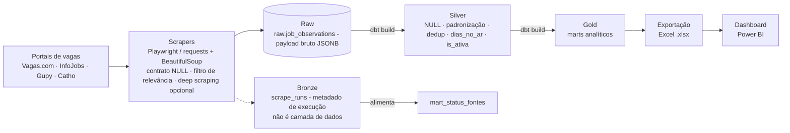

# Hub Vagas — Job Market Analytics

[](https://github.com/Willian-Cruz/hub_vagas/actions/workflows/tests.yml)


Pipeline de dados que coleta vagas de Dados e Tecnologia em portais brasileiros
e as organiza em camadas no PostgreSQL seguindo a **arquitetura medallion**:

- **Raw** — `raw.job_observations`: payload bruto JSONB de cada coleta, append-only, dedup por `payload_hash`.
- **Bronze** — `bronze.scrape_runs`: snapshot append-only de execução por fonte (monitoramento de freshness; **não é camada de dados**).
- **Silver** — `silver.jobs`: normalização, deduplicação e limpeza a partir da raw (NULLs, senioridade, salário, modalidade, dias_no_ar, is_ativa).
- **Gold** — `gold.mart_*`: matérias analíticos a partir do Silver (7 marts).

O Python (via `main.py`) é responsável **apenas pela ingestão** (scrape → raw `raw.job_observations`).
A transformação é responsabilidade do **dbt** (via `transform.py`), que move os dados da raw para Silver e Gold.
A exportação para Excel e o dashboard no Power BI consomem a Gold.

A execução é em **lote (batch)**: uma vez por dia via Agendador de Tarefas do Windows (06:00, São Paulo), ou manualmente.

---

## Arquitetura



| Etapa | Onde fica | O que faz |
| --- | --- | --- |
| **Ingestão** | `app/main.py`, `app/services/pipeline_service.py`, `app/services/collector_service.py` | Roda cada scraper em sequência (falha de um não interrompe os outros), grava vagas brutas em `raw.job_observations` (dedup por `payload_hash`) e registra status em `bronze.scrape_runs`. O Python aplica contrato de NULL e filtro de relevância por título; normalização e dedup de negócio ficam no dbt. Métricas separam `records_inserted` / `records_updated` / `records_duplicated` / `records_rejected`. |
| **Relevância** | `app/services/relevance_service.py` | Marca `is_relevant` / `motivo_relevancia` em **todas** as vagas (Opção A: nada é descartado no scraper; a Silver filtra nos marts). |
| **Raw** | `app/repositories/job_repository.py` | `raw.job_observations` (landing zone, append-only): `raw_payload` JSONB, `payload_hash`, `is_relevant`. `public.jobs` é legado (migração 004); não é mais gravada pelo Python. |
| **Bronze** | `app/repositories/bronze_repository.py` | Snapshot imutável de execução por fonte em `bronze.scrape_runs` para freshness (fonte `bronze` no dbt com `filter: status in ('SUCCESS','PARTIAL')`). |
| **Silver** | `dbt/models/staging/`, `dbt/models/intermediate/`, `dbt/macros/` | Executado via `python app/transform.py`. Campo sem informação é `NULL`. Padroniza senioridade, localidade, salário, modalidade; mantém todas as linhas com `dedup_group_id` + `is_canonical` + `first_seen_at` / `last_seen_at` + `dias_no_ar` + `is_ativa`. |
| **Gold** | `dbt/models/marts/` | Executado via `python app/transform.py`. 7 marts: `mart_vagas`, `mart_vagas_por_dia`, `mart_vagas_por_origem_localidade`, `mart_demanda_tecnologias`, `mart_status_fontes`, `mart_salarios`, `mart_qualidade_campos`. |
| **Orquestração** | `app/main.py`, `app/scheduler.py`, `app/services/scheduler_service.py` | Apenas ingestão: coleta e gravação na raw. Transformação disparada separadamente via `transform.py`. |
| **Transformação** | `app/transform.py`, `app/run_dbt.py` | Ponto de entrada do dbt. Executa `dbt build` (raw → Silver → Gold). |
| **Exportação** | `app/services/export_service.py`, `app/export_excel.py` | Gera `data/exports/vagas.xlsx` a partir de `gold.mart_vagas`. |

---

## Modelo de dados

A tabela `raw.job_observations` é mantida pelo Python (`JobRepository.salvar()`). O schema `bronze` (`scrape_runs`) é mantido pelo SQLAlchemy. A Silver (`silver.jobs`) e a Gold (`gold.mart_*`) são criadas pelo dbt.

### Raw — `raw.job_observations` (landing zone, append-only)

| Coluna | Tipo | Restrição | Origem |
| --- | --- | --- | --- |
| `id` | bigserial | PK | Auto |
| `run_id` | uuid | NOT NULL | Pipeline (UUID da execução) |
| `source` | text | NOT NULL | Scraper (Vagas.com, InfoJobs, Gupy, Catho) |
| `source_job_id` | text | — | Scraper (id_externo) |
| `collected_at` | timestamptz | NOT NULL | Pipeline |
| `payload_hash` | text | NOT NULL | Repository (SHA-256 do raw_payload) |
| `raw_payload` | jsonb | NOT NULL | Scraper (payload bruto, sem normalização) |
| `is_relevant` | boolean | NOT NULL DEFAULT true | RelevanceService (filtro por título) |
| `created_at` | timestamptz | NOT NULL DEFAULT now() | Pipeline |

Dedup Raw: mesma `(source, source_job_id)` + `payload_hash` não é regravada (última observação vence).

### Bronze — `bronze.scrape_runs` (monitoramento de execução)

Snapshot append-only de execução por fonte.

| Coluna | Tipo | Restrição |
| --- | --- | --- |
| `run_id` | uuid | PK (composto com `source`) |
| `source` | string | PK (composto com `run_id`) |
| `status` | string | NOT NULL |
| `pages_processed` | int | NOT NULL, default 0 |
| `jobs_found` | int | NOT NULL, default 0 |
| `error` | text | — |
| `started_at` | timestamptz | NOT NULL |
| `finished_at` | timestamptz | NOT NULL |
| `created_at` | timestamptz | NOT NULL, default `now()` |

Freshness: `filter: status in ('SUCCESS','PARTIAL')`; warn 24 h / error 72 h.

### Silver — `silver.jobs` (normalização + dedup)

| Coluna | Tipo | Notas |
| --- | --- | --- |
| `raw_job_id` | int | FK para raw.id |
| `origem` | string | — |
| `link` | string | — |
| `id_externo` | string | — |
| `titulo` | string | NOT NULL |
| `empresa` | string | NULL = desconhecido |
| `senioridade` | string | Normalizada (9 valores) |
| `localizacao` | string | Preposições minúsculas |
| `descricao` | text | — |
| `salario_texto` | string | Salário como publicado |
| `salario_min` | numeric | Valor mínimo extraído |
| `salario_max` | numeric | Valor máximo extraído |
| `salario_tipo` | string | faixa / exato / a_combinar / nao_informado |
| `modalidade` | string | Remoto / Híbrido / Presencial / NULL |
| `experiencia` | string | — |
| `escolaridade` | string | — |
| `qtd_posicoes` | int | — |
| `data_publicacao` | timestamptz | UTC; precisão em `data_publicacao_precisao` |
| `data_atualizacao` | timestamptz | UTC; apenas Catho preenche |
| `chave_conteudo` | string | Dedup cross-portal |
| `data_coleta` | timestamptz | — |
| `dedup_group_id` | string | Grupo de dedup |
| `first_seen_at` | timestamptz | Primeira coleta do grupo |
| `last_seen_at` | timestamptz | Última coleta do grupo |
| `is_canonical` | boolean | true = linha mais recente do grupo |
| `dias_no_ar` | numeric | Diferença entre first_seen_at e last_seen_at em dias |
| `is_ativa` | boolean | true se vista nos últimos 3 dias |

Dedup Silver: todas as linhas são mantidas (nenhuma apagada); cada grupo de conteúdo recebe `dedup_group_id`, `first_seen_at`/`last_seen_at` e `is_canonical` (linha mais recente do grupo). Os marts usam apenas `is_canonical = true`. A dedup é **por portal**: a mesma vaga em dois portais conta duas vezes.

### Gold — Marts analíticos

| Mart | Granularidade | Uso |
| --- | --- | --- |
| `mart_vagas` | 1 linha/vaga (canônicas) | Export Excel, Power BI |
| `mart_vagas_por_dia` | (data, origem) | Tendência volume + `pct_com_descricao_completa` |
| `mart_vagas_por_origem_localidade` | (origem, local, senioridade) | Heatmap geo/sênior |
| `mart_demanda_tecnologias` | tecnologia | Ranking techs (25 termos da seed) |
| `mart_status_fontes` | origem | Monitoramento freshness |
| `mart_salarios` | (origem, senioridade) | Cobertura salarial: total, n_com_salario, média, mediana |
| `mart_qualidade_campos` | (fonte, campo, data) | Saúde do parser por campo |

---

## Regras de dados

- **Campo sem informação é `NULL`.** Nunca "Não informado". O dbt aplica `null_if_placeholder` para textos tipo "Confidencial", "Localização não informada".
- **Relevância.** Todas as vagas são gravadas em `raw.job_observations` com `is_relevant` / `motivo_relevancia`. A Silver filtra `is_relevant = true` nos marts. Isso permite responder "quantas vagas boas o filtro descartou?" com uma consulta à Silver.
- **Deduplicação.** Raw: dedup por `(origem, id_externo)` + `payload_hash`. Silver: todas as linhas mantidas com `dedup_group_id` + `is_canonical`; marts usam só as canônicas. Dedup é **por portal**.
- **Senioridade.** Única fonte de verdade: macro dbt `normalize_seniority` + `classify_seniority_cascade`. "PL/SQL", "PL-SQL", "PL SQL" e "PL-300" **não** são Pleno. O rótulo "Liderança" é aceito como entrada. Testes dbt de borda em `dbt/tests/assert_seniority_edge_cases.sql`.
- **Modalidade.** Remoto, Híbrido ou Presencial. Quando o portal não informa, vem da localização ("Home Office" vira Remoto).
- **Salário.** "A combinar" **não** é fallback da descrição; só aparece quando o portal informa explicitamente. Colunas: `salario_texto`, `salario_min`, `salario_max`, `salario_tipo`.
- **Datas.** `data_publicacao` em UTC (`timestamptz`); precisão `hora` / `dia` / `estimada`. `data_atualizacao` separada para Catho. Conversão para São Paulo só na apresentação. `mart_vagas_por_dia` usa `data_coleta`.

---

## Estrutura do projeto

```text
hub_vagas/
├── .github/workflows/
│   └── tests.yml       # CI: pytest + lock de dependências a cada push/PR
├── app/
│   ├── config/settings.py   # leitura do .env (DB_* / DATABASE_URL)
│   ├── database/            # conexão e modelos SQLAlchemy
│   ├── repositories/        # job_repository, bronze_repository
│   ├── schemas/job_schema.py # validação Pydantic (JobSchema com detail_url)
│   ├── scrapers/
│   │   ├── base_scraper.py       # Template Method: loop páginas, retry+jitter,
│   │   │                         fetch_detail_page, _merge_detail_into_vaga
│   │   ├── vagas_scraper.py      # Playwright + deep scraping (MAX_DETAIL_PAGES=5)
│   │   ├── infojobs_scraper.py   # requests + BeautifulSoup
│   │   ├── gupy_scraper.py       # Playwright (feature flag GUPY_ENABLED=false)
│   │   ├── catho_scraper.py      # requests + parser dedicado
│   │   ├── catho_parser.py       # Parser HTML Catho
│   │   └── parser_utils.py       # Utilitários de parsing
│   ├── services/
│   │   ├── collector_service.py  # Orquestra scrapers + RelevanceService
│   │   ├── pipeline_service.py   # Pipeline (advisory lock + métricas novas/revisadas)
│   │   ├── relevance_service.py  # Filtro por título (termos de dados)
│   │   ├── normalize_service.py  # Normalização: local, empresa, modalidade
│   │   ├── export_service.py     # Geração Excel
│   │   ├── scheduler_service.py  # APScheduler (cron/intervalo)
│   │   └── notifier.py           # Webhook/e-mail de falha
│   ├── utils/                 # logger, text_utils, date_utils
│   ├── tests/                 # testes + conftest.py + fixtures/ (HTML real)
│   ├── main.py                # INGESTÃO: scrape → raw.job_observations
│   ├── transform.py           # TRANSFORMAÇÃO: dbt build
│   ├── run_dbt.py             # CLI dbt com credenciais do .env
│   ├── scheduler.py           # Agendador CLI (diário/intervalo)
│   ├── export_excel.py        # Exporta gold.mart_vagas → .xlsx
│   └── notifier.py            # Notificação de falha (Discord/Telegram/SMTP)
├── dbt/
│   ├── macros/                # normalize_seniority, classify_seniority_cascade,
│   │                          # extract_salary, salario_min/max/tipo, monitored_technologies
│   ├── models/
│   │   ├── sources.yml        # Fontes: raw_observations.job_observations + bronze.scrape_runs
│   │   ├── staging/           # stg_*_jobs (lê de raw_observations.job_observations)
│   │   ├── intermediate/      # int_jobs_unioned → int_jobs_normalized → int_jobs_deduped → silver.jobs
│   │   └── marts/             # 7 marts Gold (+grants select: ['bi_reader'])
│   ├── seeds/
│   │   ├── tecnologias_monitoradas.csv   # 25 termos (fonte única)
│   │   └── termos_relevancia.csv
│   ├── tests/
│   │   ├── assert_seniority_edge_cases.sql   # PL/SQL, PL-300, Liderança
│   │   ├── assert_qualidade_campos_desvio_7d.sql
│   │   ├── assert_volume_semanal_fonte.sql
│   │   ├── assert_contrato_python_dbt_columns.sql
│   │   ├── assert_silver_*.sql               # unicidade, NULL%, placeholders
│   │   └── assert_gold_tecnologias.sql
│   ├── dbt_project.yml        # vars: freshness, qualidade, volume; +grants bi_reader
│   └── profiles.yml.example
├── docs/
│   ├── adr/
│   │   ├── 0001-jobs-como-raw.md   # raw.job_observations, first/last_seen_at
│   │   └── 0002-filtro-de-relevancia.md  # Opção A: salvar tudo, Silver filtra
│   └── compliance.md               # Conformidade da coleta (robots.txt, termos, rate limit)
├── infra/
│   ├── migrate.py                    # Aplica migrações SQL pendentes
│   └── migrations/
│       ├── 001_job_technologies_primary_key.sql
│       ├── 002_jobs_data_coleta.sql
│       ├── 003_bronze_layer.sql
│       ├── 004_jobs_novos_campos.sql
│       ├── 005_drop_bronze_job_observations.sql  (DROP TABLE IF EXISTS)
│       ├── 006_raw_job_observations.sql
│       ├── 007_schema_migrations.sql
│       └── 008_role_bi_reader.sql
├── scripts/
│   ├── task_hub_vagas_coletadiaria.xml   # Agendador de Tarefas Windows
│   └── registrar_tarefa_coletadiaria.ps1 # Registra a tarefa no Windows
├── requirements.in              # Dependências não-pinadas (fonte para pip-compile)
├── requirements.txt             # Dependências travadas (saída do pip-compile)
├── .env.example               # Template variáveis de ambiente (sem segredos)
└── README.md
```

---

## Portais

| Portal | Coleta | Situação |
| --- | --- | --- |
| Vagas.com | Playwright (scroll infinito) + BeautifulSoup | Implementado: ID, data de publicação, posições, local, nível, descrição do card. Deep scraping (MAX_DETAIL_PAGES=5) busca descrição completa e salário na página de detalhe |
| InfoJobs | requests + BeautifulSoup, paginado | Implementado: salário, experiência, escolaridade, modalidade, data exata, ID |
| Gupy | Playwright + BeautifulSoup, por termos de busca | Feature flag `GUPY_ENABLED=false` (seletores a calibrar). Delegação de senioridade ao dbt e filtro de relevância centralizado já aplicados |
| Catho | requests + BeautifulSoup, paginado, por termo de busca | Implementado: scraper `CathoScraper` ativo + parser `catho_parser.py`. Empresa, local, posições, salário, data de publicação/atualização, senioridade pelo título. Salva `raw_payload` em `raw.job_observations` |
| Remotar, Sólides | — | Planejados (guia em ARCHITECTURE §7.6) |
| LinkedIn, Indeed, Glassdoor | — | Planejados |

---

## Tecnologias identificadas nas descrições

25 termos monitorados em `dbt/seeds/tecnologias_monitoradas.csv` (fonte única, compartilhada com o Python): Python, SQL, AWS, Azure, GCP, Spark, Airflow, Kafka, Docker, Kubernetes, PostgreSQL, MySQL, Oracle, MongoDB, Power BI, Tableau, Databricks, Snowflake, **dbt, BigQuery, Redshift, Excel, Git, Looker, Qlik, plsql, r, javascript, terraform**.

A extração é feita por regex no dbt sobre a seed; mudar o CSV e rodar `dbt seed` + `dbt build` muda o resultado.

---

## Como executar

### 1. Instalação

```bash
git clone https://github.com/Willian-Cruz/hub_vagas.git
cd hub_vagas
python -m venv venv
source venv/bin/activate        # Windows: venv\Scripts\activate
pip install -e .                # instalação editável (entry points: hub-vagas-ingest, hub-vagas-transform, hub-vagas-scheduler)
playwright install chromium
```

### 2. Configuração

```bash
cp .env.example .env
```

```env
DB_USER=seu_usuario
DB_PASSWORD=sua_senha
DB_HOST=localhost
DB_PORT=5432
DB_NAME=hub_vagas
```

Notificação de falha (opcional): `NOTIFICACAO_WEBHOOK_URL` (Discord/Telegram) ou `SMTP_HOST` + `SMTP_USER`/`SMTP_PASS` + `NOTIFICACAO_EMAIL_FROM/TO`.

Se o InfoJobs não conseguir validar o certificado TLS em rede com proxy corporativo, configure `REQUESTS_CA_BUNDLE`.

### 3. Migrações

Aplique as migrações pendentes com `python infra/migrate.py`:

| Migração | O que faz |
| --- | --- |
| `000` | Cria tabelas base legacy (`jobs`, `technologies`, `job_technologies`) — idempotente, aplica primeiro em banco limpo |
| `001` | Chave primária da tabela de associação `job_technologies` |
| `002` | Adiciona `jobs.data_coleta` |
| `003` | Cria o schema `bronze` com `scrape_runs` |
| `004` | Adiciona campos em `jobs`; troca placeholders por `NULL`; índice único `(origem, id_externo)` |
| `005` | Remove `bronze.job_observations` (`DROP TABLE IF EXISTS`) |
| `006` | Cria `raw.job_observations` com `raw_payload JSONB`, `payload_hash`, `is_relevant` |
| `007` | Cria `public.schema_migrations(arquivo, aplicado_em, checksum_sha256)` |
| `008` | Cria a role `bi_reader` (somente leitura em `gold`, `silver` e `bronze.scrape_runs`) |
| `009` | Adiciona `ingested_at` e `scraper_version` em `raw.job_observations` (linhagem) |
| `010` | Adiciona coluna física `link` em `raw.job_observations` (identidade, dedup e rastreabilidade) |

Uma migração que apague dados (ex.: `005`) exige backup antes de aplicar:

```bash
pg_dump -h localhost -p 5432 -U usuario -d hub_vagas -f backup_antes_da_migracao.sql
python infra/migrate.py          # aplica as pendentes
python infra/migrate.py --verificar  # lista pendentes sem aplicar
```

`select * from public.schema_migrations` mostra o que foi aplicado em cada banco.

### 4. Pipeline — Ingestão e Transformação (etapas separadas)

#### 4a. Ingestão: coleta → raw `raw.job_observations`

```bash
# Execução única (via entry point ou script direto)
hub-vagas-ingest
# ou: python app/main.py

# Agendado: todo dia às 06:00, São Paulo
hub-vagas-scheduler
# ou: python app/scheduler.py

# Com transformação dbt após cada coleta
hub-vagas-scheduler --com-transformacao
# ou: python app/scheduler.py --com-transformacao
```

#### 4b. Transformação: raw → Silver → Gold (via dbt)

```bash
hub-vagas-transform          # dbt build (modelos + testes)
# ou: python app/transform.py
python app/transform.py source freshness
python app/run_dbt.py build
```

### 5. Camadas dbt

O `app/run_dbt.py` lê o `.env` e configura a conexão. O perfil sem segredos é `dbt/profiles.yml.example`. O `build` cria os schemas `silver` e `gold`.

| Camada | Origem | Modelos | Materialização |
| --- | --- | --- | --- |
| Raw | scrapers → `raw.job_observations` | tabela `raw.job_observations` | tabela |
| Bronze | `bronze.scrape_runs` | tabela `scrape_runs` | tabela |
| Silver | raw `raw.job_observations` → `silver.jobs` | `stg_*`, `int_jobs_*`, `jobs` | view / tabela |
| Gold | Silver → `gold.mart_*` | 7 marts | tabela |

---

## Conexão Power BI → PostgreSQL

> **Não use o usuário do pipeline** (do `.env`) no Power BI: ele tem permissão de gravação. Um `.pbix` compartilhado com essa credencial entrega permissão de escrita. Use a role somente-leitura `bi_reader`.

1. Crie a role `bi_reader` (veja `infra/migrations/008_role_bi_reader.sql`; defina a senha fora do repositório):

   ```sql
   CREATE ROLE bi_reader LOGIN password '<defina-fora-do-repo>';
   GRANT CONNECT ON DATABASE hub_vagas TO bi_reader;
   GRANT USAGE ON SCHEMA gold TO bi_reader;
   GRANT SELECT ON ALL TABLES IN SCHEMA gold TO bi_reader;
   ALTER DEFAULT PRIVILEGES IN SCHEMA gold GRANT SELECT ON TABLES TO bi_reader;
   ```

   O dbt recria as tabelas Gold a cada build e perde os grants; `dbt_project.yml` declara `+grants: select: ['bi_reader']` nos modelos `marts/`.

2. No Power BI Desktop: **Obter Dados → PostgreSQL database**
3. Informe host, porta, database e credenciais de `bi_reader`
4. Selecione as tabelas do schema `gold`
5. Carregue e modele no Power BI

Para `pg_dump`/`psql` manual, use `PGPASSWORD` ou `.pgpass`, nunca a senha na URL.

---

## Como manter rodando todo dia

O APScheduler roda num processo local e para quando o PC dorme. Para execução confiável diária, use o Agendador de Tarefas do Windows:

1. Registre a tarefa (PowerShell como Administrador):

   ```powershell
   .\scripts\registrar_tarefa_coletadiaria.ps1
   ```

   Cria a tarefa `HubVagas\ColetaDiaria`, que roda todo dia às 06:00 (São Paulo) executando
   `venv\Scripts\python.exe app\main.py` seguido de `venv\Scripts\python.exe app\transform.py`.
   Se o PC estiver dormindo às 06:00, a tarefa é disparada assim que possível após a inicialização.

2. Notificação de falha: configure `NOTIFICACAO_WEBHOOK_URL` ou SMTP no `.env`. Quando o código de saída for diferente de 0, o pipeline envia aviso via webhook ou e-mail (fallback: apenas log).

3. Retry com backoff: os scrapers tentam até 3 vezes com backoff exponencial + jitter para erros de rede (`BaseScraper.coletar_com_retry()`).

4. Trava contra execução simultânea: o pipeline usa `pg_try_advisory_lock`.

---

## Testes

```bash
cd app
pytest tests/ -m "not integration" -q --tb=short
```

Testes de integração (requerem PostgreSQL):

```bash
cd app
pytest tests/integration/ -m integration -q --tb=short
```

A suíte de unidade usa um mock global do banco (`conftest.py`), então roda sem PostgreSQL. Os parsers do Vagas.com, InfoJobs e Catho são testados contra **HTML real** dos portais (`app/tests/fixtures/`).

O GitHub Actions roda, a cada push/PR na `main`:
1. Testes unitários (sem banco)
2. Testes de integração com `services: postgres`
3. `dbt build` com PostgreSQL (valida modelos e testes de dados)
4. Lint com ruff (bloqueia merge em falha)
5. Detecção de secrets com detect-secrets
6. Scan de vulnerabilidades com pip-audit

**Última validação (Fase 3.3):** dbt build **PASS=184, WARN=3, ERROR=0, SKIP=0**; pytest **323 passed** (testes de unidade — integração requer PostgreSQL no CI); ruff **0 erros novos**; pip-audit **sem vulnerabilidades** em requirements.txt e requirements-dev.txt; detect-secrets **0 segredos** (baseline limpo); lockfiles `requirements.txt`/`requirements-dev.txt` **reproduzíveis** em Python 3.11; CI **7 jobs independentes** (deps, lint, test, integration, dbt-build, security, pip-audit); instalação editável (`pip install -e .`) com 3 entry points funcionais.

---

## Histórico

| Etapa | Entregas |
| --- | --- |
| 1 a 2 | Estrutura, conexão com PostgreSQL, persistência e validação com Pydantic |
| 3 | Scrapers do Vagas.com e InfoJobs, coleta consolidada no CollectorService |
| 4 | Extração de tecnologias e relação many-to-many `jobs` ↔ `technologies` |
| 5 | Normalização de senioridade e localização, extração de salário |
| 6 a 7 | AnalyticsService, PipelineService com métricas, APScheduler e logging estruturado |
| 8 | Deploy em Render (Cron Job + PostgreSQL), Docker e dashboard HTML no GitHub Pages |
| 9 (jun/2026) | Deploy em nuvem e dashboard HTML descontinuados; análise migrada para Excel + Power BI |
| 10 (out/2026) | Correções de métricas do pipeline, código de saída do `main.py` e testes do repositório |
| 11 | Camadas Bronze, Silver e Gold: coleta append-only em JSONB, transformações e testes de dados com dbt, exportação a partir do mart Gold e tabela `jobs` mantida como legado |
| 12 (nov/2026) | Revisão dos scrapers do Vagas.com e InfoJobs com HTML real: campos vazios viram `NULL`, novos campos, filtro de relevância, deduplicação por ID e conteúdo (migração `004`) |
| 13 (nov/2026) | Senioridade em cascata (portal, título, descrição e experiência), parser da Catho com HTML real, correções no InfoJobs: modalidade pelos três ícones do card |
| 14 (nov/2026) | Arquitetura medallion com `raw.job_observations` como raw; `bronze.scrape_runs` como metadado de execução; `scheduler.py` desacoplado do dbt |
| 15 (nov/2026) | Coleta e parser da Catho com HTML real, staging `stg_catho_jobs` no dbt, scripts de verificação de qualidade, ajustes na macro `classify_seniority_cascade` |
| 16 (nov/2026) | **Fase 1 — Dados**: `dias_no_ar` / `is_ativa` na Silver; métricas novas vs revistas; salário estruturado (`salario_texto`/`min`/`max`/`tipo`, sem "A combinar" como fallback); `mart_salarios` com mediana/média por senioridade+origem; senioridade única no dbt (PL/SQL e PL-300 não são Pleno; "Liderança" reconhecida); 25 termos de tecnologias na seed; dedup por portal documentado; ADRs 0001 e 0002 |
| 17 (nov/2026) | **Fase 2 — Qualidade automática**: source freshness com `filter` em `bronze.scrape_runs`; limiares em `vars:` do `dbt_project.yml`; testes de desvio de qualidade vs mediana 7d e volume vs média semanal; `check_*.py` removidos da raiz (lógica em testes dbt); `data_publicacao` como `timestamptz` (UTC); `data_atualizacao` para Catho; teste de contrato Python↔dbt |
| 18 (nov/2026) | **Fase 3 — Operação, CI, segurança e compliance**: Windows Task Scheduler (XML + PowerShell); notificação de falha (webhook/e-mail); retry com backoff; advisory lock; `schema_migrations` + `migrate.py`; role `bi_reader` + `+grants` no dbt; `docs/compliance.md`; CI com `services: postgres`, pytest integration, ruff, pre-commit, pip-tools lock (`requirements.in`) |
| 19 (nov/2026) | **Fase 4 — Refinamentos**: `detail_url` no `JobSchema`; `fetch_detail_page` / `_merge_detail_into_vaga` no `BaseScraper`; deep scraping para Vagas.com (descrição completa + salário); guia de expansão para portais (Remotar, Sólides, LinkedIn, Indeed, Glassdoor); `AnalyticsService` auditado e funcional (consulta Gold); `.env.example` limpo (sem Cloud Run/Cloud SQL/DASHBOARD_URL); `ARCHITECTURE.md` consolidado no README |
| 20 (nov/2026) | **Fase 3 — Qualidade, Testes e Observabilidade**: contratos de dados documentados (`docs/data_dictionary/contracts.md`, `docs/data_dictionary/data_dictionary.md`); qualidade dbt reforçada (validação salario_min<=max, precisão/recall de tecnologias, severidade documentada); testes E2E e integração (ambiente PostgreSQL isolado, migrations automáticas, cenários A-G, CI com `services: postgres` e dbt build a cada push/PR); observabilidade (logs estruturados com `run_id`, `mart_saude_pipeline` consolidado, condições de alerta documentadas); dependências e segurança (requirements.in/requirements.txt separados, requirements-dev.in/requirements-dev.txt, Dependabot, pip-audit no CI, `.github/dependabot.yml`) |
| 21 (nov/2026) | **Fase 3.1 — Estabilização, correção e validação integrada**: CI/CD consolidada (workflow único `tests.yml` com jobs: deps, lint, test, integration, dbt-build, security, pip-audit; `pip-compile` correto; baseline do detect-secrets); testes de integração e E2E em PostgreSQL real (7 cenários A–G); coluna física `link` em `raw.job_observations` (migração 010); validadores Pydantic (título/link/origem não vazios); advisory lock fail-closed; status de execução coerente (erros de persistência → FALHADO/PARTIAL); logs estruturados JSON com `log_event()`; migration 000 para banco limpo; contrato dbt atualizado com `link`; `pyproject.toml` `requires-python = ">=3.11"` |
| 22 (nov/2026) | **Fase 3.2 — Estabilização do CI/CD, qualidade de dados e validação E2E**: migração 000 corrigida (bug `p.name[0:4].isdigit()` que falhava para `000_`); `dbt/sources.yml` criado (fontes `raw_observations` e `bronze`); macro `select_raw_jobs` corrigida para usar `source('raw_observations', 'job_observations')`; macro `monitored_technologies` sincronizada com a seed (30 tecnologias); Cenário A do E2E reescrito para fluxo completo Raw → Silver → Gold com 10 vagas (valida Silver `silver.jobs`, Gold `gold.mart_vagas` com tecnologias detectadas, e linhagem `run_id`/`ingested_at`/`scraper_version`); 4 testes de advisory lock (disponível, ocupado, liberação após falha, concorrência); `dbt build` em banco limpo com 184 PASS; `pip install -e .` funcional com `requires-python = ">=3.11"` |
| 23 (nov/2026) | **Fase 3.3 — Estabilização definitiva CI/CD, qualidade, E2E e segurança**: Python padronizado em 3.11 (`requires-python = "==3.11.*"`); lockfiles `requirements.txt`/`requirements-dev.txt` regenerados e reproduzíveis (Python 3.11); 7 jobs CI independentes (deps, lint, test, integration, dbt-build, security, pip-audit); testes E2E 7 cenários A–G validados; executor `infra/migrate.py` testado (15 testes); status do pipeline padronizados `SUCCESS`/`PARTIAL`/`FAILED`; contadores unificados (`records_inserted`/`records_updated`/`records_duplicated`/`records_rejected`); `JSONFormatter` preserva `component` lógico; 7 alertas implementados no `notifier.py`; `mart_saude_pipeline` sincronizado; `.secrets.baseline` limpo (sem falsos positivos); `pip-audit` sem vulnerabilidades; branch protection documentada; instalação editável (`pip install -e .`) com 3 entry points (`hub-vagas-ingest`, `hub-vagas-transform`, `hub-vagas-scheduler`) |

---

## Fase 3 — Qualidade, Testes e Observabilidade

Esta fase fortaleceu o projeto com cinco melhorias (M08 a M15):

### M08 — Testes de integração e ponta a ponta
- Ambiente de teste isolado com PostgreSQL (`app/tests/integration/conftest.py`)
- Migrations aplicadas automaticamente antes dos testes
- Testes de persistência (`test_persistence.py`): inserção, dedup, payload JSONB, linhagem
- Testes E2E (`test_e2e.py`): cenários A–G (sucesso, dados incompletos, duplicidade, fonte indisponível, banco indisponível, falha de transformação, alteração na fonte)
- CI executa dbt build em todo push/PR (não apenas schedule semanal)

### M11 — Qualidade dos modelos dbt
- `assert_salario_valido.sql`: salario_min <= salario_max, sem negativos, a_combinar sem valores, faixa com min+max
- `assert_tecnologias_precisao_recall.sql`: precisão/recall da classificação de tecnologias com dataset rotulado (32 exemplos)
- `assert_contrato_tipos_raw.sql`: detecção de mudanças incompatíveis em colunas da raw
- Severidade documentada em cada teste (error para invariantes, warn para limitações conhecidas)

### M13 — Observabilidade
- Logs estruturados JSON com `run_id`, `source`, `component`, `stage`, `event`, `status`, métricas de registros (`app/utils/logger.py`, função `log_event`)
- `mart_saude_pipeline` (Gold): visão consolidada de saúde por fonte (taxa de sucesso/falha, duração, volume, última coleta, status de saúde)
- `assert_saude_pipeline.sql`: verifica fontes sem sucesso ou desatualizadas
- Condições de alerta documentadas (`docs/operations/observabilidade.md`)

### M14 — Contratos de dados
- `docs/data_dictionary/contracts.md`: contratos de entrada (JobSchema), persistência (raw.job_observations), saída (Silver/Gold), semântica de NULL, datas, moeda, identificadores
- `docs/data_dictionary/data_dictionary.md`: dicionário completo de colunas por camada
- Política de evolução de contratos (mudanças compatíveis vs incompatíveis)

### M15 — Dependências e segurança
- `requirements.in` (produção) e `requirements-dev.in` (dev/test) separadas
- `requirements.txt` e `requirements-dev.txt` travados via pip-compile
- `.github/dependabot.yml`: atualizações automatizadas semanais
- `pip-audit` no CI: scan de vulnerabilidades em ambos os lockfiles
- `requirements.lock` removido (redundante)

### M14/M15 — Fase 3.3: CI/CD, Packaging e Segurança
- Python padronizado em **3.11** (`requires-python = "==3.11.*"`) — lockfiles reproduzíveis
- CI reorganizada: **7 jobs independentes** (deps, lint, test, integration, dbt-build, security, pip-audit)
- Testes E2E: **7 cenários A–G** validados (sucesso, dados incompletos, duplicidade, fonte indisponível, banco indisponível, falha dbt, alteração estrutural)
- Executor `infra/migrate.py` testado (**15 testes**: aplicação, idempotência, detecção de alteração, concorrência, recuperação)
- Status do pipeline padronizados: **`SUCCESS` / `PARTIAL` / `FAILED`** (eliminados `SUCESSO`/`FALHADO`)
- Contadores unificados: `records_inserted`/`records_updated`/`records_duplicated`/`records_rejected`
- `JSONFormatter` preserva `component` lógico passado via `log_event()`
- **7 alertas implementados** no `notifier.py` (fonte sem execução, falhas consecutivas, queda volume, desvio qualidade, persistência raw, dbt falha, dados desatualizados)
- `mart_saude_pipeline` sincronizado com novos status (`SUCCESS`/`PARTIAL`/`FAILED`/`EMPTY`)
- `.secrets.baseline` limpo — **0 segredos** (falsos positivos de CI removidos)
- `pip-audit`: **nenhuma vulnerabilidade** em requirements.txt nem requirements-dev.txt
- Branch protection documentada (`docs/operations/branch-protection.md`) com 7 checks obrigatórios
- Instalação editável (`pip install -e .`) com **3 entry points**: `hub-vagas-ingest`, `hub-vagas-transform`, `hub-vagas-scheduler`

---

## Próximos passos

- Calibrar os seletores do scraper da Gupy e ativar (`GUPY_ENABLED=true`) quando houver fixtures reais
- Implementar deep scraping para InfoJobs e Catho (página de detalhe)
- Adicionar portais Remotar, Sólides, LinkedIn, Indeed e Glassdoor (guia em ARCHITECTURE §7.6)
- Publicar prints do dashboard do Power BI neste README

---

## Autor

**Willian da Cruz** — projeto de estudo e portfólio em Engenharia de Dados.

[](https://www.linkedin.com/in/williandacruz/)
[](https://github.com/Willian-Cruz)

## Licença

MIT. Veja o arquivo [LICENSE](LICENSE).
