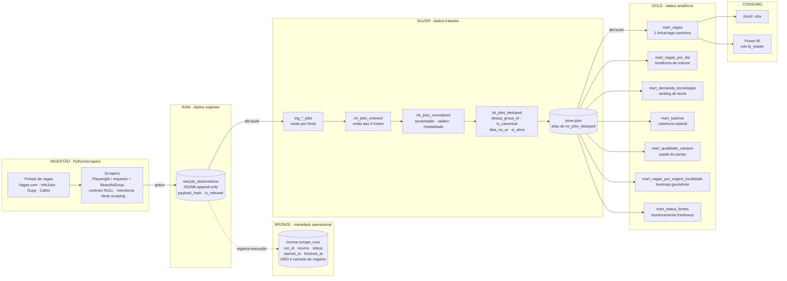

# Fluxo de Dados — Hub Vagas

Este documento descreve o fluxo real de dados do projeto, da coleta nos portais
até o consumo analítico no Power BI / Excel.

---

## Visão geral



---

## Detalhamento por etapa

### 1. Ingestão (`app/scrapers/`)

Os navegadores (scrapers) acessam os portais e extraem os dados dos cards de vaga.

- **Contrato NULL:** campo sem informação vira `None`, nunca texto tipo "Não informado".
- **Filtro de relevância:** `RelevanceService.separar()` marca `is_relevant` / `motivo_relevancia` em todas as vagas (Opção A: nada é descartado no scraper).
- **Deep scraping (opcional):** `VagasScraper` pode buscar a página de detalhe para descrição completa e salário (`MAX_DETAIL_PAGES=5`).

### 2. Raw (`raw.job_observations`)

Cada observação de coleta é gravada como uma linha append-only com o payload bruto em JSONB.

| Campo | Finalidade |
|-------|------------|
| `id` (PK) | Identificador da observação (observation_id para linhagem) |
| `run_id` | UUID da execução de coleta |
| `source` | Nome do portal (Vagas.com, InfoJobs, Gupy, Catho) |
| `source_job_id` | ID da vaga no portal, quando disponível |
| `collected_at` | Momento da coleta no portal |
| `ingested_at` | Momento da persistência no banco |
| `scraper_version` | Versão do scraper utilizado |
| `payload_hash` | SHA-256 do payload bruto (dedup de retransmissão idêntica) |
| `raw_payload` | Payload bruto do scraper (JSONB), sem normalização |
| `is_relevant` | Resultado do filtro de relevância por título |

**Dedup Raw:** mesma `(source, source_job_id, payload_hash)` não é regravada.

### 3. Bronze (`bronze.scrape_runs`)

Snapshot append-only de execução por fonte. É **metadado operacional**, não camada de negócio.

| Campo | Finalidade |
|-------|------------|
| `run_id` | UUID da execução |
| `source` | Nome do portal |
| `status` | `success`, `partial`, `failed`, `empty` |
| `pages_processed` | Quantidade de páginas processadas |
| `jobs_found` | Quantidade de vagas encontradas |
| `started_at` / `finished_at` | Intervalo de execução |

**Freshness:** `filter: status in ('success','partial')`; warn 24h / error 72h.

### 4. Silver (`silver.jobs`)

Pipeline dbt: `stg_*_jobs` → `int_jobs_unioned` → `int_jobs_normalized` → `int_jobs_deduped`.

| Transformação | O que faz |
|---------------|-----------|
| Staging (`stg_*_jobs`) | Views por fonte, lê de `raw.job_observations` |
| Unioned (`int_jobs_unioned`) | União das 4 fontes, limpeza básica (NULL_IF placeholder) |
| Normalized (`int_jobs_normalized`) | Senioridade, salário, modalidade, localização |
| Deduped (`int_jobs_deduped`) | Dedup cross-portal, `is_canonical`, `dias_no_ar`, `is_ativa` |

**Linhagem (M09):** `run_id`, `scraper_version`, `ingested_at` são propagados da raw para a Silver. Flags de inferência (`senioridade_inferida`, `salario_inferido`) identificam quando um campo foi derivado e não veio diretamente do portal.

**Dedup Silver:** todas as linhas são mantidas com `dedup_group_id` e `is_canonical`. Os marts usam apenas `is_canonical = true`.

### 5. Gold (`gold.mart_*`)

Marts analíticos agregados a partir do Silver.

| Mart | Granularidade | Uso |
|------|---------------|-----|
| `mart_vagas` | 1 linha/vaga (canônicas) | Export Excel, Power BI |
| `mart_vagas_por_dia` | (data, origem) | Tendência de volume |
| `mart_vagas_por_origem_localidade` | (origem, local, senioridade) | Heatmap geo/sênior |
| `mart_demanda_tecnologias` | tecnologia | Ranking de techs |
| `mart_status_fontes` | origem | Monitoramento freshness |
| `mart_salarios` | (origem, senioridade) | Cobertura salarial |
| `mart_qualidade_campos` | (fonte, campo, data) | Saúde do parser |

### 6. Consumo (Power BI / Excel)

O Power BI lê diretamente do schema `gold` usando a role `bi_reader` (somente leitura). O Excel é gerado a partir de `gold.mart_vagas`.

---

## Reconstrução da linhagem (exemplo prático)

Para responder "de onde veio este dado?" a partir de um indicador do Gold:

```
Gold mart_demanda_tecnologias (Python: 42%)
    │
    ▼
Silver silver.jobs (vagas com Python na descrição/título)
    │  ├─ run_id → execução de coleta
    │  ├─ source → portal de origem
    │  ├─ scraper_version → versão do coletor
    │  └─ ingested_at → momento da persistência
    │
    ▼
Raw raw.job_observations (payload bruto JSONB)
    │  ├─ payload_hash → identificador do conteúdo coletado
    │  └─ raw_payload → HTML do card / dados da API
```

Não é necessário armazenar uma lista de IDs dentro de cada linha agregada do Gold; basta que existam os relacionamentos (`run_id`, `raw_job_id`) para reconstruir o caminho.
